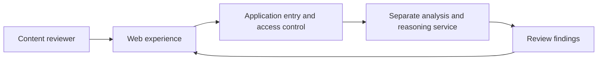

# High-level architecture

The public scaffold represents only the application entry and service interface.
Service internals, detailed data processing, and product implementations are
outside this publication. The running evaluation prototype is the source of
evidence for the complete user experience.

## Google deployment description

The final submission must identify the actual Cloud Run/Firebase entry and explain
the Google services used in the working product. Deployment URLs and integration
evidence have not yet been supplied for this repository. See the
[integration status](google-cloud-integration.md).
