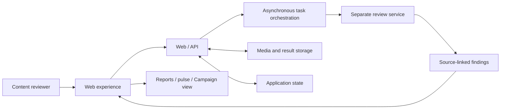

# Architecture

The submission deck describes a web review experience supported by asynchronous
analysis, a separately maintained review service, and persistent media and
application state.

| Component | Role described in the submission deck |
| --- | --- |
| Next.js / FastAPI | Creative submission and review interface |
| Dagster | Asynchronous workflow orchestration |
| Qwen 3.5 Omni | Generative interpretation and pulse reasoning |
| Kaggle GPU tasks | Auxiliary measurement execution |
| Tencent COS | Creative assets and results |
| PostgreSQL | Persistent application state |

The diagram describes product-level responsibilities. This public repository
implements only the HTTP entry scaffold and abstract service boundary. Review
service internals, data processing, and model instructions remain separately
maintained.

See [deployment and integrations](google-cloud-integration.md).
